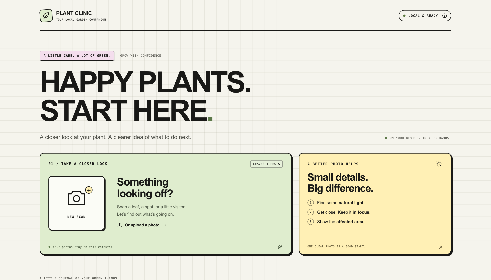
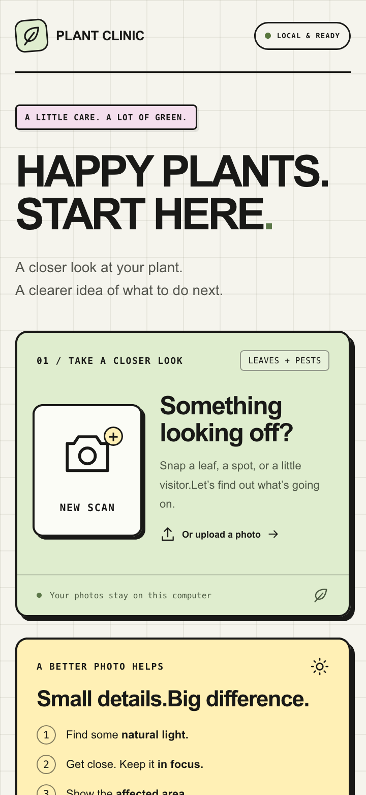
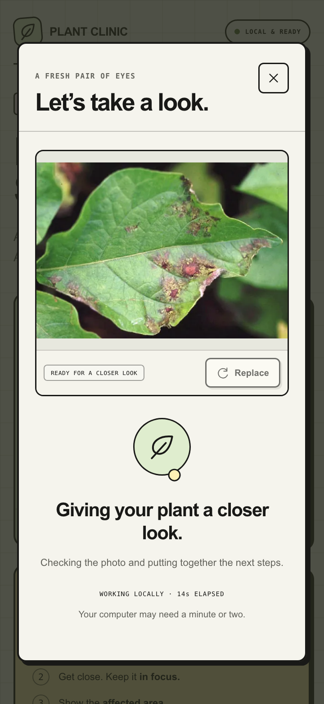
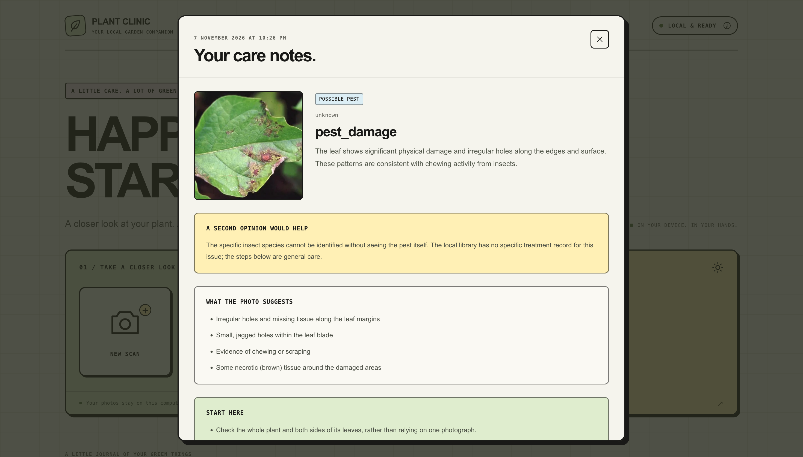

# SHN-MEDIAPIPE

# 🌿 Plant Clinic

### 💡 What's the idea?

Plant Clinic is a local web app that helps you investigate plant diseases and garden pests from a photo. Capture or upload an image, get a possible identification with care and prevention guidance, and revisit your saved scans—all on a single computer.

### 🌐 Check it out!

- **Live Website:** N/A — runs locally at `http://localhost:8000`.
- **GitHub Repo:** [godlykmathews/SHN-MEDIAPIPE](https://github.com/godlykmathews/SHN-MEDIAPIPE)
- **Live Demo (YouTube):** https://youtu.be/Gbx4RItzKkI

### 🛠️ What did you use?

- **Frontend:** HTML, CSS, and vanilla JavaScript, with the browser camera API.
- **Backend:** Python, FastAPI, and Uvicorn.
- **Local AI:** Ollama for image interpretation and explanations.
- **MediaPipe:** Integration for compatible specialist plant-disease and pest classifiers.
- **Image processing:** Pillow and NumPy.
- **Storage:** SQLite for scan history and local files for images.
- **Validation and communication:** Pydantic and HTTPX.

Current image analysis uses Ollama vision. A specialist MediaPipe model still needs to be installed to enable that recognition path. Reports show the analysis method and uncertainty.

[Setup, run instructions, and technical details](docs/SETUP.md)

### 👥 The Humans Behind It

- Godly K Mathews — [@godlykmathews](https://github.com/godlykmathews)

### ⚙️ Hardware Corner

Built on an Laptop. The webpage, backend, database, and Ollama models run on the same machine. Use a camera for new photos or upload existing images; no separate hardware server is required.

### 📸 Show Us What You Built!

<table>
  <tr>
    <td width="140"></td>
    <td align="center"></td>
    <td width="140"></td>
    <td align="center"></td>
    <td width="140"></td>
  </tr>
</table>

_YouTube walkthrough coming soon—see the Live Demo link above once added._

### ✨ Cool Things It Does

- Capture a photo with the camera or upload a JPEG, PNG, or WebP image.
- Suggest possible plant diseases or pests and explain what the photo shows.
- Provide care and prevention steps from a local library with source links.
- Save images and reports on the server, so history survives browser refreshes and app restarts.
- Reopen, filter, retry, or delete past scans.
- Run locally with a simple, boxy UI inspired by Saturday Hack Night.

---

**Built with curiosity at Saturday Hack Night 💜**
